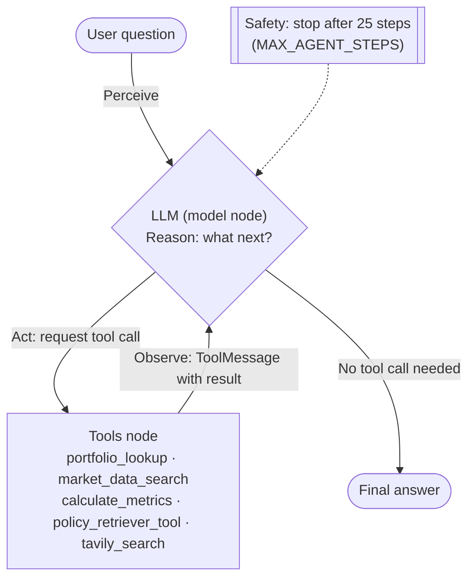
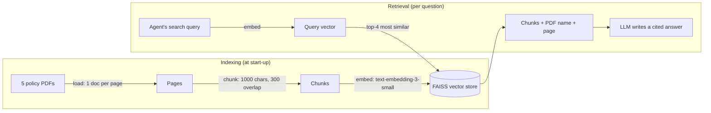
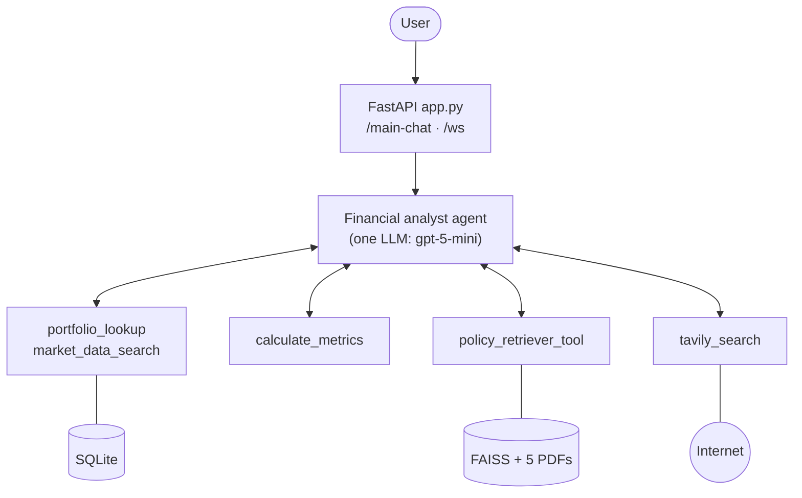
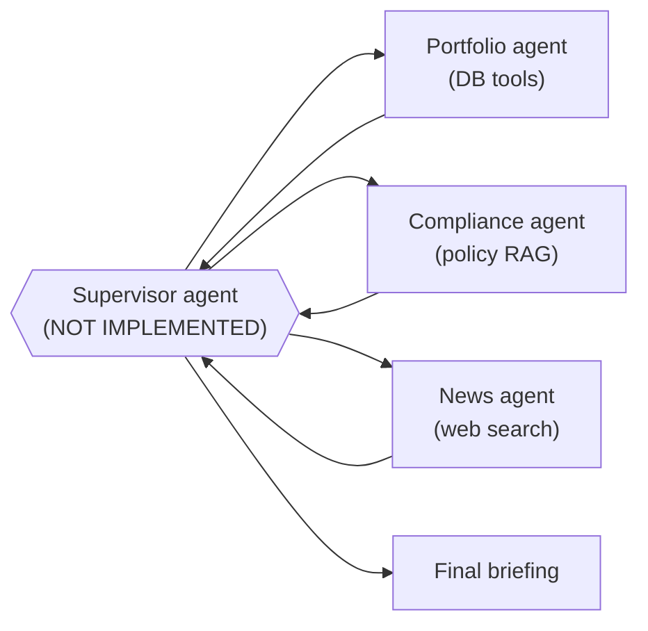

# Financial Analyst Agent: a beginner's guide to Agentic AI

This project is a working **AI agent** that acts like a junior financial analyst at a fictional Indian wealth-management firm, *Meridian Wealth Partners*. It answers questions about client portfolios. To do that it looks up a database, searches the firm's policy PDFs, does calculations and reads live news.

This README is written for **new team members with no AI background**. Read it top to bottom and you should be able to explain how an AI agent works, and point to the exact code that does each part.

> **How to read file references:** `Src/agent.py:46` means *file `Src/agent.py`, line 46*. Every concept below links to the code that implements it. Lines marked `# CONCEPT:` in the code are teaching comments that match the sections of this README.

---

## Contents

1. [What is Agentic AI?](#1-what-is-agentic-ai)
2. [Project overview](#2-project-overview)
3. [Setup and running the project](#3-setup-and-running-the-project)
4. [Core concepts](#4-core-concepts)
   - 4.1 [Core operating loop](#41-core-operating-loop-perceive--reason--act--observe)
   - 4.2 [Tool use (function calling)](#42-tool-use-function-calling)
   - 4.3 [Memory architectures](#43-memory-architectures)
   - 4.4 [RAG (Retrieval-Augmented Generation)](#44-rag-retrieval-augmented-generation)
   - 4.5 [Planning and the system prompt](#45-planning-and-the-system-prompt)
   - 4.6 [Multi-agent architecture](#46-multi-agent-architecture)
   - 4.7 [Safety](#47-safety)
   - 4.8 [Observability and control](#48-observability-and-control)
5. [Project map: every file and what it teaches](#5-project-map-every-file-and-what-it-teaches)
6. [Assumptions and known gaps](#6-assumptions-and-known-gaps)
7. [Glossary](#7-glossary)
8. [Learning path](#8-learning-path)
9. [Exercises](#9-exercises)

---

## 1. What is Agentic AI?

### The short version

A **Large Language Model (LLM)** is an AI system trained on huge amounts of text. You give it text (a *prompt*) and it writes a reply. ChatGPT is built on an LLM.

A plain **chatbot** uses an LLM in one step: *question in, answer out*. It can only use what it already "remembers" from training. It cannot look anything up, and it does not check its own work.

An **AI agent** wraps the LLM in a loop and gives it **tools**. Tools are ordinary functions it can ask to run, such as "look up client CLT-001 in the database". The agent:

1. **Perceives**: reads your request.
2. **Reasons**: decides what it needs to know or do next.
3. **Acts**: calls a tool, for example a database query.
4. **Observes**: reads the tool's result.
5. **Repeats** steps 2–4 until it has enough information, then writes the final answer.

**Agentic AI** is the general idea of building AI systems this way. The AI does not just answer; it plans, takes actions, and uses the results to decide what to do next.

### An analogy

| | Plain chatbot | AI agent |
|---|---|---|
| Like… | A colleague answering from memory in a hallway conversation | A capable assistant at a desk with a database, a filing cabinet, a calculator and a newspaper |
| You ask "Is Rajesh's portfolio within our risk policy?" | Gives a plausible-sounding guess | Looks up Rajesh's holdings, opens the risk policy, does the maths, then answers and says which page of the policy it used |
| Can be wrong because… | It has never seen Rajesh's portfolio | A tool returned bad data, or it chose the wrong tool, but you can **see every step it took** and check |

### Why this matters

LLMs on their own are known to **hallucinate**, which means confidently making things up. Agents reduce this by **grounding** answers in real data the tools fetch. They also make the AI's work **inspectable**: you can read the list of steps it took.

---

## 2. Project overview

### What the agent does

You type a question such as:

> *"Client CLT-003 wants to buy more Adani Enterprises. Check his current holding as a percentage of his portfolio, look up our single-stock concentration limit for Aggressive investors, and advise whether this is allowed."*

The agent decides on its own to:

1. Call `portfolio_lookup` → reads CLT-003's holdings from a **SQLite database**.
2. Call `calculate_metrics` → works out the Adani percentage exactly.
3. Call `policy_retriever_tool` → searches the firm's **policy PDFs** for the concentration rule (this is **RAG**, explained in §4.4).
4. Write an answer that cites the policy document and page number.

### What is inside

| Part | Technology | Where |
|---|---|---|
| The "brain" (LLM) | OpenAI `gpt-5-mini` | [`Src/agent.py:321`](Src/agent.py:321) |
| Agent loop | LangChain `create_agent` (built on LangGraph) | [`Src/agent.py:321`](Src/agent.py:321) |
| 5 tools | Python functions + Tavily web search | [`Src/agent.py:117-260`](Src/agent.py:117), [`Src/agent.py:103`](Src/agent.py:103) |
| Client & market data | SQLite file `data/meridian_wealth.db` (5 clients, 23 holdings, 10 stocks) | [`Src/db_queries.py`](Src/db_queries.py) |
| Policy knowledge | 5 PDFs in `policy_documents/`, searched with FAISS | [`Src/rag_pipeline.py`](Src/rag_pipeline.py) |
| Web server / API | FastAPI | [`app.py`](app.py) |
| Chat web page | HTML + JavaScript | [`frontend/`](frontend/static/index.html) |

### Why it is a good learning example

- It is **small**: the agent logic is one file of about 400 lines.
- It uses **all three common data sources** an agent needs: a database (exact facts), documents (rules, via RAG) and the web (fresh news).
- It shows a **real reason** to use an agent. A useful briefing needs several look-ups whose order depends on what earlier look-ups returned.
- Every step is **visible** in the response, so you can watch the agent think.

> ⚠️ All clients, prices and policies are fictional training data. The agent's output is **not financial advice**.

---

## 3. Setup and running the project

### Prerequisites

| You need | Why | How to check |
|---|---|---|
| Python **3.11 or 3.12** | Runs the code | `py --version` (Windows) or `python3 --version` |
| An **OpenAI API key** | The LLM and the embeddings for RAG. Paid; a full run costs a few cents | [platform.openai.com](https://platform.openai.com) |
| A **Tavily API key** | Live web/news search. Has a free tier | [tavily.com](https://tavily.com) |
| Git | To get the code | `git --version` |

> **No keys yet?** You can still run the [offline demo](#step-5-try-the-offline-demo-no-keys-needed) and the database tools. Only the LLM-powered chat needs keys.

### Step 1: Open a terminal in the project folder

```powershell
cd "C:\all projects\financial agent"
```

### Step 2: Create a virtual environment

A **virtual environment** (venv) is a private Python install for this project, so its packages don't clash with other projects.

```powershell
py -3.12 -m venv .venv
```

```powershell
.\.venv\Scripts\Activate.ps1
```

(macOS/Linux: `python3 -m venv .venv` then `source .venv/bin/activate`.)

### Step 3: Install packages

`requirements.txt` is the full training-course list. It includes large packages this app does not use, such as `torch`, `crewai` and `autogen`. To install **only what this app needs** (much faster):

```powershell
pip install "langchain>=1.0" "langchain-core>=1.0" "langchain-openai>=1.0" "langchain-community>=0.3" langchain-text-splitters langchain-tavily faiss-cpu pypdf python-dotenv "pydantic>=2" fastapi "uvicorn[standard]"
```

Or install everything with `pip install -r requirements.txt`.

### Step 4: Add your API keys

Create a file named `.env` in the project root (it is already in `.gitignore`, so it will never be committed):

```text
OPENAI_API_KEY=sk-...your key...
TAVILY_API_KEY=tvly-...your key...
```

The code reads this file at start-up ([`app.py:19-21`](app.py:19), [`Src/agent.py:20-22`](Src/agent.py:20)).

### Step 5: Try the offline demo (no keys needed)

```powershell
python examples/offline_agent_loop.py
```

This runs the real tools and the real agent loop, but replaces the LLM with a scripted fake. You will see the loop, the safety step-limit and memory in action. Details are in [Exercise 1](#exercise-1-watch-the-loop-run-offline).

### Step 6: Start the web app

Run this **from the project root**, because the policy-PDF path is relative to where you start:

```powershell
python app.py
```

At start-up the app checks the database, creates the LLM, and **builds the RAG index**: it reads the 5 PDFs, splits them into chunks and sends them to OpenAI for embedding. Look for `✅ Agent initialized successfully` in the console.

| Open | What you get |
|---|---|
| http://localhost:8000 | Chat web page |
| http://localhost:8000/docs | Auto-generated API documentation where you can try every endpoint |
| http://localhost:8000/health | Which components started correctly |

### Step 7: Ask a question from the command line (optional)

```powershell
python examples/run_agent.py 3
```

This runs sample question 3 and prints the **full step-by-step trace**, then the answer. Use `1`–`4` for the built-in samples, or pass your own question in quotes.

### API endpoints at a glance

| Method & path | Uses the LLM? | Purpose | Code |
|---|---|---|---|
| `POST /main-chat` | Yes | Ask the agent; returns answer + tools used + steps | [`app.py:209`](app.py:209) |
| `POST /api/query` | Yes | Same as `/main-chat` (older name, used by the web page as a fallback) | [`app.py:266`](app.py:266) |
| `WS /ws` | Yes | WebSocket: sends each tool call/result, then the answer (used by the web page) | [`app.py:318`](app.py:318) |
| `GET /health` | No | Component status | [`app.py:116`](app.py:116) |
| `GET /agent-info` | No | Agent description and tool list | [`app.py:146`](app.py:146) |
| `GET /api/clients` | No | List the 5 clients | [`app.py:281`](app.py:281) |
| `GET /api/client/{id}` | No | One client's raw portfolio | [`app.py:294`](app.py:294) |
| `GET /api/market/{ticker}` | No | Market data for a stock or sector | [`app.py:306`](app.py:306) |

Example request (PowerShell):

```powershell
Invoke-RestMethod -Method Post -Uri http://localhost:8000/main-chat -ContentType "application/json" -Body '{"query": "Summarise the portfolio of CLT-002"}'
```

### Troubleshooting

| Symptom | Cause and fix |
|---|---|
| `OPENAI_API_KEY not found` | `.env` missing or in the wrong folder. It must sit next to `app.py`. |
| `/health` shows `"rag_pipeline": "warning"` | PDFs not found. Start the app **from the project root**. |
| `UnicodeEncodeError: 'charmap' codec…` on Windows | The console can't print emoji. Run `$env:PYTHONIOENCODING = "utf-8"` first. |
| `Agent error: Recursion limit of 25 reached` | The agent used up its step budget (see §4.7). Ask a narrower question. |

---

## 4. Core concepts

Each concept has: **definition → where it is in the code → a short example**. Concepts this project does *not* implement are marked **Not implemented in this project**.

### 4.1 Core operating loop (perceive → reason → act → observe)

**Definition.** The heartbeat of every agent. The loop repeats until the LLM decides it has enough information:

- **Perceive**: take in the user's request (and, later, tool results).
- **Reason**: the LLM reads everything so far and decides: *call a tool* or *give the final answer*.
- **Act**: run the tool the LLM asked for.
- **Observe**: add the tool's output to the conversation so the LLM can read it next time round.

This pattern is called **ReAct** (*Reasoning + Acting*).



ASCII version:

```text
 user question
      │  (perceive)
      ▼
 ┌──────────┐  wants a tool (act)   ┌───────────┐
 │   LLM    │ ────────────────────► │   tools   │
 │ (reason) │ ◄──────────────────── │ (run code)│
 └──────────┘   result (observe)    └───────────┘
      │  no more tools needed
      ▼
 final answer
```

**Where it is in the code.**

| Step | Code |
|---|---|
| Build the loop | `create_agent(...)` in [`Src/agent.py:321`](Src/agent.py:321). LangChain builds a two-node graph (*model* and *tools*) and loops between them. The `while` loop lives inside the library, not in this project's code. |
| Perceive | The question becomes a `{"role": "user", ...}` message in [`invoke_agent`, `Src/agent.py:361-369`](Src/agent.py:361) |
| Reason | The LLM call inside the graph, guided by `SYSTEM_PROMPT` ([`Src/agent.py:283`](Src/agent.py:283)) |
| Act | The tool functions ([`Src/agent.py:117-260`](Src/agent.py:117)) |
| Observe | The library adds each tool's return value as a `ToolMessage` |
| Stop | When the LLM answers without asking for a tool, or when `MAX_AGENT_STEPS` is reached ([`Src/agent.py:46`](Src/agent.py:46)) |

**Example (a real trace from `examples/offline_agent_loop.py`).**

```text
Step 0 | USER: How is client CLT-001 doing?                         ← perceive
Step 1 | AGENT -> calls 1 tool(s):                                  ← reason + act
    portfolio_lookup({"client_id": "CLT-001"})
Step 2 | TOOL RESULT from portfolio_lookup: {"client_id": ...}      ← observe
Step 3 | AGENT -> calls 1 tool(s):                                  ← reason + act again
    calculate_metrics({"expression": "return on 2532500 vs cost 1894000"})
Step 4 | TOOL RESULT from calculate_metrics: ... = +33.71%          ← observe
Step 5 | FINAL ANSWER (79 chars)                                    ← loop ends
```

The result of `agent.invoke()` is the full list of these messages. That is why the app can show every step.

### 4.2 Tool use (function calling)

**Definition.** A **tool** is a normal function the LLM may ask to run. The LLM **never runs code itself**. It replies with a structured request ("call `portfolio_lookup` with `client_id='CLT-001'`"), the framework runs the function, and the result is passed back. This mechanism is called **function calling**.

**Where it is in the code.** The `@tool` decorator turns a Python function into a tool. Its **name**, **type hints** and **docstring** become the description the LLM reads to decide *when* to use it ([`Src/agent.py:109-116`](Src/agent.py:109)).

| Tool | What it does | Data source | Code |
|---|---|---|---|
| `portfolio_lookup` | Client's holdings, returns, sector mix, risk profile | SQLite | [`Src/agent.py:118`](Src/agent.py:118) |
| `market_data_search` | Price, YTD return, P/E, rating for a ticker/sector | SQLite | [`Src/agent.py:175`](Src/agent.py:175) |
| `calculate_metrics` | Exact return / percentage / comparison maths | Pure Python | [`Src/agent.py:197`](Src/agent.py:197) |
| `policy_retriever_tool` | Finds relevant policy text with document + page | FAISS (RAG) | [`Src/agent.py:236`](Src/agent.py:236) |
| `tavily_search` | Latest news (3 results) | Tavily web API | [`Src/agent.py:103`](Src/agent.py:103) |

The tools are handed to the agent in one list: [`Src/agent.py:307`](Src/agent.py:307).

**Example.** You can call a tool yourself, exactly as the agent would:

```python
from Src.agent import calculate_metrics
print(calculate_metrics.invoke({"expression": "return on 596000 vs cost 430000"}))
# Return: (₹596,000 - ₹430,000) / ₹430,000 = +38.60%
```

Two design lessons in the tools:

- **Do maths in code, not in the LLM.** LLMs are unreliable at arithmetic, so `calculate_metrics` does it in Python ([`Src/agent.py:201`](Src/agent.py:201)).
- **Return helpful errors, don't crash.** If a client id is wrong, `portfolio_lookup` returns `"Client X not found. Available: CLT-001, ..."` ([`Src/agent.py:125`](Src/agent.py:125)). The LLM reads this observation and can retry with a valid id.

### 4.3 Memory architectures

"Memory" in agents means *what information the agent can see when it reasons*. There are three common kinds:

| Kind | Plain meaning | In this project? |
|---|---|---|
| **Working memory** | The scratchpad for the *current* question: the growing list of messages (question → tool calls → results) | ✅ Yes, always |
| **Short-term memory** | Remembering earlier questions *in the same conversation* | ✅ Yes, **only when a `session_id` is sent** |
| **Long-term memory** | Remembering facts *across* conversations and restarts (e.g. "this user prefers crores") | ❌ **Not implemented in this project** |

**Working memory: where it is.** The `messages` list inside one `agent.invoke()` call. Each loop iteration appends to it, and the LLM re-reads the whole list every time it reasons. You can see it in the trace in §4.1. It is thrown away when the call ends.

**Short-term memory: where it is.**

- A **checkpointer** (`InMemorySaver`) saves the message list after each step, keyed by a **thread id** ([`Src/agent.py:48-56`](Src/agent.py:48)).
- `invoke_agent(query, session_id=...)` uses the session id as the thread id ([`Src/agent.py:349-357`](Src/agent.py:349)).
- The API accepts `session_id` in the request body ([`Src/schemas.py:27-29`](Src/schemas.py:27)) and passes it through ([`app.py:226`](app.py:226)).

```powershell
# Turn 1
Invoke-RestMethod -Method Post -Uri http://localhost:8000/main-chat -ContentType "application/json" -Body '{"query": "Look up CLT-004", "session_id": "demo-1"}'
# Turn 2: "her" works because turn 1 is remembered
Invoke-RestMethod -Method Post -Uri http://localhost:8000/main-chat -ContentType "application/json" -Body '{"query": "What is her largest holding?", "session_id": "demo-1"}'
```

Limits: the memory lives in RAM and is lost on restart. Nothing trims old messages, so very long sessions grow without limit. The web page and WebSocket do **not** send a `session_id`, so they stay stateless.

**Long-term memory: not implemented.** The policy vector store (§4.4) is sometimes confused with memory. It is a **knowledge base**: fixed documents the agent can search. It never stores anything the agent learns from conversations.

### 4.4 RAG (Retrieval-Augmented Generation)

**Definition.** An LLM doesn't know your company's private documents. **RAG** solves this in two phases:

1. **Indexing** (once, at start-up): split the documents into small **chunks**, and turn each chunk into an **embedding**, a list of numbers that captures its meaning. Store them in a **vector store**.
2. **Retrieval** (per question): turn the question into an embedding too, find the chunks with the *closest* numbers (most similar meaning), and paste them into the LLM's context so it answers **from the documents**. This is **grounding**.



**Where it is in the code.**

| RAG step | Code | Setting |
|---|---|---|
| Load PDFs | [`RAGPipeline.load_documents`, `Src/rag_pipeline.py:43`](Src/rag_pipeline.py:43) | `PyPDFLoader`, one document per page, keeps `source` and `page` |
| Chunk | [`chunk_documents`, `Src/rag_pipeline.py:68`](Src/rag_pipeline.py:68) | 1000 characters, 300 overlap, splits at paragraphs first |
| Embed + index | [`build_vectorstore`, `Src/rag_pipeline.py:100`](Src/rag_pipeline.py:100) | OpenAI `text-embedding-3-small` (1,536 numbers per chunk), FAISS |
| Retrieve | [`create_retriever`, `Src/rag_pipeline.py:130`](Src/rag_pipeline.py:130) | top **k = 4** chunks |
| Wire-up at start-up | [`Src/agent.py:89-98`](Src/agent.py:89) | uses folder `policy_documents/` |
| Grounding / citations | [`policy_retriever_tool`, `Src/agent.py:236-260`](Src/agent.py:236) | labels each chunk `[Policy Doc i: <file> \| Page <n>]` |
| Rules forcing the agent to use RAG | System prompt, [`Src/agent.py:295-305`](Src/agent.py:295) | "ALWAYS use the policy_retriever_tool — never guess the rules" |

**Example.** When the agent calls `policy_retriever_tool("single stock concentration limit Aggressive")`, it receives text shaped like this:

```text
[Policy Doc 1: Risk_Management_Guidelines.pdf | Page 2]
...the relevant paragraph...
---
[Policy Doc 2: Asset_Allocation_Policy.pdf | Page 1]
...
```

The LLM then quotes the limit and cites the file and page.

**Not implemented in this project:** saving the index to disk (it is rebuilt, and the embedding API is paid again, on every start), re-ranking of results, hybrid keyword + vector search, and automated RAG quality evaluation. [`vectordb/vectordb.py`](vectordb/vectordb.py) contains a FAISS wrapper with `save`/`load`, but **nothing in the app uses it**.

### 4.5 Planning and the system prompt

**Definition.** **Planning** means deciding the order of steps to reach a goal. A **system prompt** is a set of standing instructions the LLM receives before every user message. It sets the agent's role, tools and rules.

**Where it is in the code.** `SYSTEM_PROMPT` in [`Src/agent.py:283-305`](Src/agent.py:283) does three jobs:

1. **Role**: "You are a senior financial analyst at Meridian Wealth Partners…"
2. **Tool guide**: one line per tool saying what it is for.
3. **Rules and a plan template**: e.g. "Always check the client's risk profile before making recommendations", and "For briefings, structure as: Portfolio Summary → Market Context → Policy Compliance → Recommendations".

**How planning actually happens here.** Planning is **implicit**. There is no separate planner component. At each loop step the LLM re-plans, choosing the next tool from what it has observed so far. It may also ask for **several tools at once** (the trace shows `calls 3 tool(s)`). The library then runs them in the same step.

**Not implemented in this project:** an explicit planner (e.g. "write the plan first, then execute it"), plan verification, or re-planning when a step fails beyond what the LLM does on its own.

### 4.6 Multi-agent architecture

**Definition.** A **multi-agent** system splits work between several agents, each with its own role, prompt and tools. Examples are a "researcher" agent and a "compliance checker" agent. A coordinator (an **orchestrator** or **supervisor**) passes messages between them.

**In this project: Not implemented.** This is a **single-agent** system: one LLM, one prompt, five tools. The packages `crewai` and `autogen-agentchat` appear in `requirements.txt` because it is shared with a wider course; **no code in this project imports them**.

What this project *does* have is **one agent coordinating several specialised tools**. That is the usual first step before multi-agent design:



For comparison only, here is what a multi-agent version **could** look like. ⚠️ **This is not in the code.**



### 4.7 Safety

**Definition.** **Guardrails** are checks and limits that stop an agent from doing harmful, costly or wrong things. They can be *soft* (instructions the LLM is asked to follow) or *hard* (code that enforces a rule regardless of what the LLM does).

| Safety measure | Type | What it prevents | Code |
|---|---|---|---|
| **Step limit** (`MAX_AGENT_STEPS = 25`) | Hard | An agent looping forever and running up cost | [`Src/agent.py:40-46`](Src/agent.py:40), applied at [`Src/agent.py:348`](Src/agent.py:348) |
| **Input validation** (Pydantic `QueryRequest`) | Hard | Malformed requests reaching the agent (rejected with HTTP 422) | [`Src/schemas.py:18-29`](Src/schemas.py:18) |
| **Parameterised SQL** | Hard | SQL injection through LLM-chosen values | [`Src/db_queries.py:38-45`](Src/db_queries.py:38) |
| **Read-only, fixed queries** | Hard | The agent can't write its own SQL or change data; tools only run fixed `SELECT`s | [`Src/db_queries.py`](Src/db_queries.py) |
| **No `eval()` in the calculator** | Hard | Running arbitrary code from a maths expression | [`Src/agent.py:201-204`](Src/agent.py:201) |
| **Fail fast on missing keys** | Hard | Half-working start-up; prints only *whether* a key exists, never the key | [`Src/agent.py:63-77`](Src/agent.py:63) |
| **Graceful degradation** | Hard | If RAG fails, the agent still runs and says policy search is unavailable | [`Src/agent.py:92-99`](Src/agent.py:92), [`Src/agent.py:243-244`](Src/agent.py:243) |
| **Grounding rules in the prompt** | Soft | Guessing policies or news; "If required data is missing, say so explicitly" | [`Src/agent.py:295-305`](Src/agent.py:295) |
| **Error handling in the API** | Hard | Crashes leaking as broken responses; errors return JSON with HTTP 500 | [`app.py:262-263`](app.py:262), [`app.py:397`](app.py:397) |
| **Secrets kept out of git** | Process | API keys being committed | [`.gitignore`](.gitignore) (`.env`) |

**Example.** The offline demo gives the agent a fake LLM that never stops calling tools. With `recursion_limit=6` it is stopped with `GraphRecursionError` instead of looping forever ([`examples/offline_agent_loop.py:62`](examples/offline_agent_loop.py:62)).

**Not implemented in this project:**

- **Human-in-the-loop**: a person approving an action before it happens. Not needed here because no tool changes anything, but essential if a tool could, say, place a trade.
- **Output checks**: code that verifies the final answer actually cites a policy, or that numbers match tool results. The prompt *asks* for this but nothing *enforces* it.
- **Authentication and rate limiting** on the API (anyone who can reach the server can use it; `slowapi` is listed in requirements but unused). CORS allows every origin ([`app.py:44`](app.py:44)).
- **Prompt-injection defences**: web-search results are passed to the LLM unfiltered.

### 4.8 Observability and control

**Definition.** **Observability** means being able to see what a system is doing and why. For agents, the key question is *"which steps led to this answer?"*. **Control** means being able to limit or stop the agent.

| What | How it helps | Code |
|---|---|---|
| **Trace in every chat response**: `tools_used` and `reasoning_steps` (tool + arguments) | Check an answer instead of trusting it | [`app.py:232-260`](app.py:232) |
| **Step-by-step streaming** over WebSocket: `tool_call` and `tool_result` events, shown in the web page | The user watches the loop (sent after the run finishes, not live) | [`app.py:348-375`](app.py:348) |
| **`format_agent_trace()`**: readable trace for terminals and scripts | Debugging and teaching | [`Src/agent.py:374-398`](Src/agent.py:374), used by [`examples/run_agent.py`](examples/run_agent.py) |
| **`/health` endpoint** | Monitoring tools can see which component failed | [`app.py:113-137`](app.py:113) |
| **Start-up console messages** | Shows keys present (yes/no), database found, RAG chunk count | [`app.py:51-87`](app.py:51), [`Src/rag_pipeline.py`](Src/rag_pipeline.py) |
| **Step limit** (control) | Hard stop on runaway loops | [`Src/agent.py:46`](Src/agent.py:46) |

**Not implemented in this project:**

- **Structured logging**: the code uses `print()`, not Python's `logging` module, so there are no log levels, timestamps or log files. `python-json-logger` is listed but unused.
- **A tracing platform** such as LangSmith. LangChain can send traces to LangSmith with no code change if you set the environment variables `LANGSMITH_TRACING=true` and `LANGSMITH_API_KEY`, but this project does not configure it.
- **Metrics** (latency, token cost per question), **live streaming** of tokens, and **manual overrides** (pausing or editing an agent mid-run).

---

## 5. Project map: every file and what it teaches

| File | Main contents | Concepts |
|---|---|---|
| [`Src/agent.py`](Src/agent.py) | `initialize_agent_components`, 4 `@tool` functions + Tavily, `create_financial_agent`, `invoke_agent`, `format_agent_trace`, `tools_used`, `MAX_AGENT_STEPS`, `_conversation_memory` | Operating loop, tool use, memory, planning/prompt, safety, observability, RAG grounding |
| [`Src/rag_pipeline.py`](Src/rag_pipeline.py) | `RAGPipeline` (`load_documents`, `chunk_documents`, `build_vectorstore`, `create_retriever`, `setup_complete_pipeline`, `search`), `initialize_rag_pipeline` | RAG: load, chunk, embed, retrieve |
| [`Src/db_queries.py`](Src/db_queries.py) | `query_db`, `get_client_portfolio`, `search_market_data`, `get_all_clients`, `verify_database`; also `get_client_by_id`, `get_sector_distribution`, `get_holding_concentration` (not used by any tool) | Tool back-ends, safe SQL |
| [`Src/schemas.py`](Src/schemas.py) | `QueryRequest`, `AgentResponse` (used); `PortfolioSummary`, `MarketData`, `PolicyDocument`, `ToolExecutionResult`, `ConversationHistory`, etc. (defined but **not used**) | Input validation, response shape |
| [`app.py`](app.py) | FastAPI app, start-up, REST endpoints, WebSocket `/ws`, error handler | Perceive (entry point), observability, safety |
| [`examples/offline_agent_loop.py`](examples/offline_agent_loop.py) | Scripted fake LLM + real tools: loop, step limit, memory demos | All core concepts, no keys needed |
| [`examples/run_agent.py`](examples/run_agent.py) | Runs 4 sample questions against the real agent, prints the trace | Operating loop, observability |
| [`vectordb/vectordb.py`](vectordb/vectordb.py) | `VectorStore` wrapper (add, search, save, load) | RAG storage. **Not used by the app.** |
| [`frontend/`](frontend/static/index.html) | Chat page; `main.js` connects to `/ws`, falls back to `/api/query` | Showing the trace to users |
| `data/meridian_wealth.db` | SQLite: `clients` (5), `holdings` (23), `market_data` (10) | Tool data |
| `policy_documents/*.pdf` | 5 policy PDFs used by RAG | RAG source |
| `TEST_STARTUP.py`, `DEBUG_ENVIRONMENT.py` | Start-up and environment checks | Setup help |
| `scaffold.py` | Generates the empty folder skeleton | Project history |

---

## 6. Assumptions and known gaps

These were found while reading the code. They are stated so you aren't confused by them.

1. **The `llm` object is not the agent's model.** `initialize_agent_components` creates `ChatOpenAI(model="gpt-5-mini", temperature=0.7)` ([`Src/agent.py:86`](Src/agent.py:86)), but `create_agent` is given the *string* `"openai:gpt-5-mini"` ([`Src/agent.py:322`](Src/agent.py:322)). So the `temperature=0.7` setting is **not applied**; `llm` only serves as an "initialised" flag. This is left unchanged to preserve behaviour.
2. **RAG folder.** The agent indexes `policy_documents/` relative to the folder you start the app from. An identical copy exists in `data/policy_documents/` (the `RAGPipeline` default). Extra copies of the `.db` file sit in both PDF folders; only `data/meridian_wealth.db` is used.
3. **`sources` is always empty** in chat responses; citations appear inside the answer text instead.
4. **`client_id`** in the request body is accepted but ignored. Put the client id in the question.
5. **WebSocket "streaming"** sends the steps after the agent finishes, not while it works.
6. **Short-term memory** only works through the REST endpoints with a `session_id`, and is lost on restart.
7. **Behaviour with real API keys was not re-tested** while writing this guide (no keys were available). The database tools, API routes, agent loop, step limit and memory were tested offline with a scripted model.

---

## 7. Glossary

| Term | Simple meaning |
|---|---|
| **Agent** | An AI program that loops: decide → use a tool → read the result → decide again, until done. |
| **Agentic AI** | Building AI that plans and takes actions with tools, not just answers in one step. |
| **API** | A defined way for programs to talk to each other, e.g. sending a question to OpenAI. |
| **API key** | A secret password that identifies you to a paid service. Never commit it. |
| **Checkpointer** | A component that saves the agent's message list so a conversation can continue later. |
| **Chunk** | A small piece of a document (here ~1000 characters) that is searched as one unit. |
| **Chunk overlap** | Characters repeated between neighbouring chunks so sentences at the edges aren't lost. |
| **Citation** | Saying where information came from (here: PDF name and page). |
| **CORS** | A browser rule controlling which websites may call this API. |
| **Deterministic** | Always gives the same output for the same input (like a calculator; unlike an LLM). |
| **Embedding** | A list of numbers representing the meaning of a text; similar meanings → similar numbers. |
| **Endpoint** | One URL of an API that does one job, e.g. `POST /main-chat`. |
| **Environment variable / `.env`** | Settings (like API keys) given to a program from outside the code. `.env` is a file that holds them. |
| **FAISS** | A fast library for finding the most similar embeddings. Used as the vector store. |
| **FastAPI** | The Python web framework that runs this project's API. |
| **Function calling** | The LLM replying with a structured request to run a named function with arguments. |
| **Graceful degradation** | When one part fails, the rest keeps working with reduced features. |
| **Grounding** | Making the LLM base its answer on retrieved real data rather than its memory. |
| **Guardrail** | A rule or check that keeps an agent's behaviour safe and correct. Soft = an instruction; hard = enforced by code. |
| **Hallucination** | When an LLM states something false with confidence. |
| **Human-in-the-loop** | A person must approve or edit an agent's action before it happens. |
| **JSON** | A common text format for structured data: `{"name": "value"}`. |
| **LangChain** | A Python library with building blocks for LLM apps: tools, prompts, retrievers, agents. |
| **LangGraph** | A library (used by LangChain's `create_agent`) that runs an agent as a graph of steps with loops. |
| **LLM (Large Language Model)** | An AI trained on vast text that predicts and writes text. Here: OpenAI `gpt-5-mini`. |
| **Long-term memory** | Information an agent keeps across separate conversations. Not in this project. |
| **Message** | One item in the conversation: user (`HumanMessage`), LLM (`AIMessage`), or tool result (`ToolMessage`). |
| **Multi-agent system** | Several agents with different roles working together. Not in this project. |
| **Observability** | Being able to see what a system did and why (logs, traces, health checks). |
| **Observation** | The result of a tool call, fed back to the LLM. |
| **Orchestrator / supervisor** | In multi-agent systems, the agent or code that hands work to other agents. |
| **Parameterised query** | SQL where values are passed separately (at `?` placeholders), preventing SQL injection. |
| **Planning** | Deciding which steps to take, in which order, to reach a goal. |
| **Prompt** | The text sent to an LLM. |
| **Prompt injection** | Malicious text (e.g. on a web page) that tries to give the LLM new instructions. |
| **Pydantic** | A Python library that checks data has the right shape and types. |
| **RAG (Retrieval-Augmented Generation)** | Look up relevant document chunks first, then have the LLM answer using them. |
| **ReAct** | "Reasoning + Acting": the think → act → observe loop agents use. |
| **Recursion limit** | LangGraph's maximum number of steps in one run; this project's step budget. |
| **REST** | A common style of web API using URLs and methods like GET and POST. |
| **Retriever** | The component that returns the most relevant chunks for a query. |
| **Short-term memory** | Remembering earlier turns of the same conversation. |
| **SQL / SQLite** | SQL is the language for querying tables of data; SQLite is a small database stored in one file. |
| **SQL injection** | An attack that sneaks SQL commands into a value to change or steal data. |
| **System prompt** | Standing instructions given to the LLM before every conversation: role, rules, tools. |
| **Tavily** | A web-search API designed for AI agents. |
| **Thread id** | The key that identifies one conversation in the checkpointer (here: the `session_id`). |
| **Token** | A small piece of text (about ¾ of a word) that LLMs read and write; API cost is per token. |
| **Tool** | A function the agent can ask to run, e.g. a database lookup. |
| **Top-k** | Return the *k* best matches (here k = 4). |
| **Trace** | The ordered record of every step an agent took. |
| **Vector / vector store** | A vector is a list of numbers (an embedding); a vector store saves them and finds the closest ones. |
| **Virtual environment (venv)** | A private Python installation for one project. |
| **WebSocket** | A connection that stays open so the server can send several messages to the browser. |
| **Working memory** | The messages of the current question that the LLM re-reads at every step. |

---

## 8. Learning path

Read in this order. Times are rough.

| # | Read / do | Why | Time |
|---|---|---|---|
| 1 | §1–§2 of this README | The big picture | 15 min |
| 2 | Run `python examples/offline_agent_loop.py`, then read that file | See the loop, step limit and memory work with no LLM | 20 min |
| 3 | [`Src/db_queries.py`](Src/db_queries.py) | Plain Python + SQL that the tools sit on; nothing "AI" yet | 15 min |
| 4 | [`Src/agent.py`](Src/agent.py): the four `@tool` functions | How functions become tools; why docstrings matter | 20 min |
| 5 | [`Src/agent.py`](Src/agent.py): `SYSTEM_PROMPT`, `create_financial_agent`, `invoke_agent` | The agent itself: loop, prompt, memory, step limit | 20 min |
| 6 | [`Src/rag_pipeline.py`](Src/rag_pipeline.py), then `policy_retriever_tool` | How documents become searchable and cited | 25 min |
| 7 | [`app.py`](app.py): `/main-chat` and `/ws` | How the agent is served and how its trace reaches users | 20 min |
| 8 | [`frontend/templates/main.js`](frontend/templates/main.js) (skim `handleWebSocketMessage`) | How the trace is shown in the browser | 10 min |
| 9 | With keys: `python examples/run_agent.py 1`, then the web page | Watch the real LLM choose tools | 15 min |
| 10 | Search the code for `CONCEPT:` and re-read §4 | Consolidate | 15 min |
| 11 | Do the exercises below | Practice | 1–2 h |

---

## 9. Exercises

Run all commands from the project root with the virtual environment active. Exercises 1–5 need **no API keys**.

### Exercise 1: Watch the loop run offline

```powershell
python examples/offline_agent_loop.py
```

**Expected outcome:** three sections. Demo 1 prints a 6-step trace (`USER` → `portfolio_lookup` → result → `calculate_metrics` → `+33.71%` → `FINAL ANSWER`). Demo 2 prints `Stopped by recursion_limit=6`. Demo 3 prints `2`, `4`, then `2` messages in memory.

**Explain to a colleague:** which lines are *reason*, *act* and *observe*? Why does session-B only have 2 messages?

### Exercise 2: Be the agent, call tools by hand

```powershell
python -c "from Src.agent import portfolio_lookup; print(portfolio_lookup.invoke({'client_id': 'CLT-002'}))"
```

```powershell
python -c "from Src.agent import market_data_search; print(market_data_search.invoke({'query': 'Banking'}))"
```

**Expected outcome:** JSON for **Priya Kapoor** with `"risk_profile": "Conservative"` and her holdings, then JSON for the banking stocks in `market_data`. This is exactly the *observation* the LLM would receive.

### Exercise 3: See how an agent recovers from mistakes

```powershell
python -c "from Src.agent import portfolio_lookup; print(portfolio_lookup.invoke({'client_id': 'CLT-999'}))"
```

**Expected outcome:** `Client CLT-999 not found. Available: CLT-001, CLT-002, CLT-003, CLT-004, CLT-005`. Discuss why returning this text is better for an agent than raising an exception.

### Exercise 4: Test a safety guardrail (SQL injection)

```powershell
python -c "from Src.agent import portfolio_lookup; print(portfolio_lookup.invoke({'client_id': 'CLT-001\' OR \'1\'=\'1'}))"
```

**Expected outcome:** a *not found* message. **No** client data is returned, because the value is passed as a parameter, never pasted into the SQL ([`Src/db_queries.py:38`](Src/db_queries.py:38)).

### Exercise 5: Add a step to the scripted loop

In [`examples/offline_agent_loop.py`](examples/offline_agent_loop.py), `demo_operating_loop`:

1. Add `market_data_search` to the imports and to the `tools=[...]` list.
2. Insert a new scripted step before the final answer: `call("market_data_search", {"query": "IT"}, "call_3")`.

**Expected outcome:** the trace grows to 8 steps and `Tools used:` lists three tools. Then lower the step limit in `demo_step_limit` to `recursion_limit=2` and notice it stops even sooner.

### Exercise 6: Give the agent a new tool *(needs API keys)*

[`Src/db_queries.py`](Src/db_queries.py) has `get_holding_concentration(client_id, ticker)`, which no tool uses. In [`Src/agent.py`](Src/agent.py):

1. Write a `@tool` function `holding_concentration(client_id: str, ticker: str) -> str` that calls it, with a clear docstring.
2. Add it to the `tools` list in `create_financial_agent` and one line to the system prompt's tool list.
3. Run `python examples/run_agent.py "What percentage of CLT-003's portfolio is ADANIENT?"`

**Expected outcome:** the trace shows `holding_concentration(...)` being called (possibly instead of `portfolio_lookup` + `calculate_metrics`). Try removing the docstring detail and see whether the agent still picks it. This shows that **the docstring is the tool's instruction manual for the LLM**.

### Exercise 7: Short-term memory over the API *(needs API keys)*

Start the app, then send the two requests from §4.3 with `"session_id": "demo-1"`. Repeat turn 2 **without** `session_id`.

**Expected outcome:** with the session id, the agent knows who "her" is (CLT-004, Sunita Reddy). Without it, the agent says it doesn't know which client you mean, or asks.

### Exercise 8: Tune RAG and watch citations change *(needs API keys)*

In [`Src/rag_pipeline.py`](Src/rag_pipeline.py), change `create_retriever(self, k: int = 4)` to `k: int = 1`, restart, and ask sample question 3 (`python examples/run_agent.py 3`). Then try `chunk_size=300`.

**Expected outcome:** with `k=1` the tool returns a single excerpt and the answer may miss a rule or cite fewer pages. With smaller chunks the start-up log reports many more chunks, and excerpts are shorter and more focused. Discuss the trade-off: **too little context → missing facts; too much → noise and cost**.

---

*Every teaching annotation in the code starts with `# CONCEPT:`. Search for it to jump between this guide and the code.*
